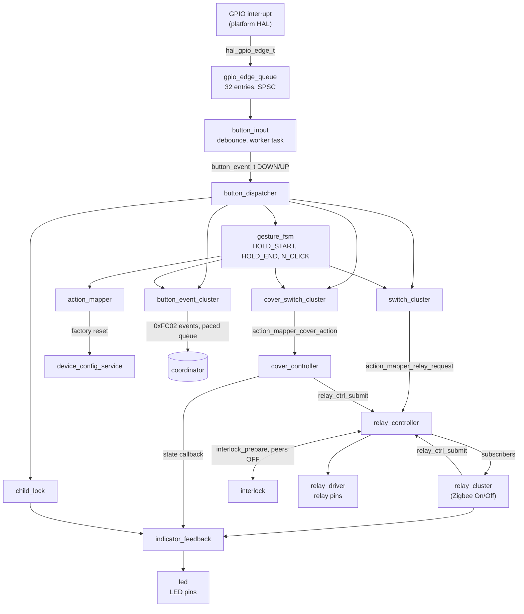

# Architecture

How the firmware is put together: what each part of `src/` owns, how a button
press becomes a relay switch, which execution context runs what, and the
checklists for extending the Zigbee interface or the device config.

## Overview

- **One image per board.** `board.mk` reads the board's entry from
  `device_db.yaml` and builds one image for it (`BOARD=<key> make board/build`).
- **Features are compiled per board.** A board's features (`relay`, `switch`,
  `cover`, `battery`, `meter`, `probe`, `interlock`) come from its `features`
  list in `device_db.yaml`, or are derived from its config tokens by
  `helper_scripts/board_features.py`. `src/features.mk` turns the list into
  `FEATURE_<NAME>=0|1` defines and adds only the sources of the selected
  features. Two images for the same MCU can therefore differ in code, not only
  in their default config string.
- **The hardware layout is read at boot.** Pins, buttons, relays, LEDs, covers
  and meters come from the *device config string* stored in NVM (the board's
  `config_str` on first boot), parsed by `src/device_config/config_parser.c`.
  The string can be rewritten over Zigbee (Device Config cluster `0xFC10`,
  attribute `Text`); the device reboots into it.
- **Behaviour is set through ZCL attributes**: standard ones and
  manufacturer-specific ones (`0xFFxx` ids in standard clusters, and the
  fork-private clusters).

## Source tree

| Path | Owns |
| --- | --- |
| `src/app.c` | `app_init()`: NVM migrations (`handle_version_changes()`), `device_config_service_init()`, diagnostics, `parse_config()`, router/end-device change check. `app_task()`: the main-loop pump (see [execution contexts](#execution-contexts)) |
| `src/hal/` | Platform contract headers: GPIO and edge capture, tasks, timer, NVM, ADC, GPIO counter, GPIO probe, Zigbee descriptors and write contract, `zigbee_limits.h` |
| `src/base_components/` | Platform-independent logic: the input pipeline (`gpio_edge_queue`, `button_input`, `button_dispatcher`, `gesture_fsm`, `action_mapper`), outputs (`relay_controller`, `relay_driver`, `interlock`, `cover_controller`), feedback (`led`, `indicator_feedback`, `network_indicator`, `child_lock`), services (`timer_service`, `diagnostics_service`, `meter_service`, `gpio_probe_service`, `battery`), the BL0937 driver in `energy_measurement/` |
| `src/zigbee/` | ZCL cluster implementations, cluster ids (`zcl_ids.h`), attribute and command ids of standard clusters (`zcl_cluster_defs.h`), the generated `management_protocol.h` |
| `src/device_config/` | Config text service and NVM record (`device_config_service`), parser (`config_parser`), validated layout (`device_composition`), graph construction and the recovery graph (`feature_wiring`), persisted per-capability state (`capability_state`), NVM item ids, migrations, reset |
| `src/telink/` | TLSR825x HAL, SDK glue and patches, makefiles, OTA packaging (`make_ota.py`, `ota_reformating/`) |
| `src/silabs/` | EFR32 HAL, SLC project files (`slcp_files/`), `custom-zcl.xml`, `zcl_config.zap`, SPI flash bootloader extension |
| `src/stub/` | Host build: HAL simulation, REPL (`commands.c`), machine-readable event output (`machine_io.c`) |

**Layering rule:** `src/base_components/` and `src/zigbee/` never include
platform headers. They reach hardware and the Zigbee stack only through
`src/hal/`; `src/telink/`, `src/silabs/` and `src/stub/` implement it.

## Input pipeline



| Stage | Module | Does |
| --- | --- | --- |
| Capture | platform HAL (`src/telink/hal/gpio_interrupts.c`, `src/silabs/hal/gpio.c`) | Timestamps each level change of a watched pin and hands it to the single edge sink (`hal_gpio_set_edge_sink`). Telink masks the watched interrupts in the ISR and re-arms them from `hal_gpio_process_pending()`; edges seen there carry `HAL_GPIO_EDGE_DEFERRED` |
| Queue | `gpio_edge_queue` | Single-producer single-consumer ring of 32 edges. On overflow the edge is counted as dropped and `button_input` re-reads every input on its next run |
| Debounce | `button_input` | Commits a level held for `debounce_ms` (default 25 ms, 1–200 ms) and emits `BUTTON_EVENT_DOWN`/`UP` with a sequence number and press id |
| Fan-out | `button_dispatcher` | Calls up to `BUTTON_SINK_MAX` (6) registered sinks in registration order |
| Gestures | `gesture_fsm` | Hold start/end after `hold_ms`, and `N_CLICK` after the multi-click gap (default 350 ms); up to `GESTURE_SINK_MAX` (6) sinks |
| Policy | `switch_cluster`, `cover_switch_cluster` | Switch mode, relay mode, binding mode, long press; send bound On/Off, Level or Window Covering commands; honour the child lock |
| Actions | `action_mapper` | Relay requests from switches, cover actions to `cover_controller_action`, factory reset on a hold of an onboard (`B`) button or a multi-press of any other button |
| Relays | `relay_controller` | The single entry for relay changes (`relay_ctrl_submit`): on/off/toggle/pulse/timed on, inching, deferral through `interlock` (peers off, dead time), state callbacks to subscribers |
| Pins | `relay_driver` | Writes relay pins; a latching relay gets a 100 ms pulse on its on or off pin, timed by `timer_service`; one pulse at a time unless the config has `SLP` |
| Events | `button_event_cluster` | Queues button and gesture events (16 entries) for the coordinator on cluster `0xFC02` |

The stub registers one extra observer on both the dispatcher and the gesture
FSM to print `btn_event` and `gesture` machine events.

### Module ownership

| Rule | Where it holds |
| --- | --- |
| Only `relay_driver` writes relay pins | `relay_controller` calls `relay_driver_apply()`; the only other caller is the recovery path in `feature_wiring.c`, which drives relays off before resetting the controller |
| Relay state changes go through `relay_ctrl_submit()` | Callers: `relay_cluster`, `action_mapper`, `cover_controller`, `interlock`, the controller's own timers |
| LEDs are driven through `indicator_feedback` | `led.c` is called only by `indicator_feedback.c`; `network_indicator`, `child_lock`, relay and cover feedback all use `indicator_feedback_*` |
| Shared code writes output pins only in drivers | `hal_gpio_write()` outside the platform layers is called only by `led.c`, `relay_driver.c` and the BL0937 driver (`SEL` pin) |
| Delayed work uses `hal_tasks` | Most modules use `timer_service` (`app_timer_t`). `button_input` (worker), `button_event_cluster` (TX task) and `gpio_probe_service` (pulse cutoff) schedule their own `hal_task_t` |
| Fixed capacities, no dynamic allocation | Every table has a compile-time bound; registration beyond it is ignored or rejected |

## Execution contexts

| Context | Runs | Allowed |
| --- | --- | --- |
| GPIO interrupt | Telink `gpio_isr_callback()`, Silabs `_dispatch_regular()` | Read levels, timestamp, push to `gpio_edge_queue` through the edge sink, set pending flags, mask GPIO interrupts (Telink). No task scheduling, no ZCL, no NVM |
| Main loop | `app_task()`, called every pass after the stack (Telink: `ev_main()`, `tl_zbTaskProcedure()`, `app_task()`) | `hal_gpio_process_pending()`, `button_input_process_pending()` (schedules the worker), `button_event_cluster_process_pending()` and `relay_ctrl_process_pending()` (retry work whose task could not be armed), probe polling, diagnostics refresh once per second, network steering and the boot announce |
| Task | `hal_tasks` callbacks; run from the main loop, never from an interrupt | Debounce and dispatch (button worker), gestures, relay and cover timers, one button event transmission per run |
| Zigbee callback | Attribute writes and cluster commands from the stack | Write callbacks follow the two-phase contract in `src/hal/zigbee.h`: `HAL_ZIGBEE_ATTR_VALIDATE` checks without side effects, `HAL_ZIGBEE_ATTR_COMMIT` applies, stores and persists |

Queue boundaries:

- **Interrupt to main loop:** `gpio_edge_queue` (32 edges). The producer copies
  the item before publishing the index; Telink captures from the main loop
  with interrupts masked so the queue keeps a single producer.
- **Main loop to tasks:** pending flags. `hal_tasks_schedule()` returns false
  when the platform cannot arm a task (Telink's shared event timer pool is
  full); the module counts the failure and retries from the main loop.
- **Pipeline to Zigbee:** the button event queue (16 entries, 40 ms between
  transmissions, 100 ms retry after a failed send, 5 s time to live). Events
  are queued only while joined; a full queue drops the oldest entry.

## Composition and features

```text
device_db.yaml features / config tokens
  └─ helper_scripts/board_features.py features <BOARD>
       └─ src/features.mk: FEATURE_SOURCES, FEATURE_<NAME>=0|1
            └─ src/device_config/build_features.h (build fails if a define is missing)

boot: device_config_service_init()            config text from NVM
      └─ parse_config()                       src/device_config/feature_wiring.c
           ├─ config_parser_parse()           tokens -> device_composition_t
           │    ├─ token_feature_compiled()   token of a missing feature -> CONFIG_PARSE_FEATURE_MISSING
           │    └─ device_composition_validate()  counts, pins, references
           ├─ feature_wiring_build()          preflight against platform limits, then wire
           └─ feature_wiring_start()          register sinks, add buttons, hal_zigbee_init()
```

- `device_composition_t` is the validated, platform-free description of the
  device: buttons, switches, relays, covers, indicators, meters, interlock
  groups, battery pin, child lock LED.
- `feature_wiring` turns a composition into drivers, controllers and
  endpoints. Endpoints are numbered from 1 in the order switches, relays,
  cover switches, covers (a config with none still gets endpoint 1).
- A parse error, a token whose feature is not compiled, a graph over the
  platform limits, or a refused `hal_zigbee_init()` sets Device Config
  `LastError` (`PARSE`, `FEATURE_MISSING`, `RESOURCE`) and boots the
  [recovery graph](#recovery-graph).
- A config written over Zigbee runs the same parser and preflight before it
  is stored (`device_config_service_preflight()`), so a write the firmware
  could not run is rejected instead of stored.
- `src/features.mk` refuses `meter` together with `probe` (they share the
  TLSR8258 GPIO-to-RISC sources) and `cover` without `interlock`.
  `board_features.py` adds `interlock` to every board with a cover, the probe,
  a `K` token or more than one relay.

## Resource limits

`src/hal/zigbee_limits.h` holds the smallest capacity of all platforms, so one
config produces the same graph on Telink and Silabs:

| Limit | Value |
| --- | --- |
| `HAL_ZIGBEE_MAX_ENDPOINTS` | 8 |
| `HAL_ZIGBEE_MAX_SERVER_CLUSTERS` / `HAL_ZIGBEE_MAX_CLIENT_CLUSTERS` | 32 / 32 |
| `HAL_ZIGBEE_MAX_CLUSTERS` | 48 |
| `HAL_ZIGBEE_MAX_ATTRIBUTES` | 160 |
| `HAL_ZIGBEE_MAX_ZCL_REGISTRATIONS` (Telink ZCL cluster table) | 48 |

Composition limits in `src/device_config/device_composition.h`:

| Item | Max |
| --- | --- |
| Relays (`R` tokens plus two per cover) | 10 |
| Buttons (`B`, `S`, and 2–3 per `X`) | 11 |
| Switches | 10 |
| Indicators (`L`, `I`) | 5 |
| Covers / cover switches | 3 / 3 |
| Meters | 2 |
| Interlock groups | 10 |
| Endpoints | `HAL_ZIGBEE_MAX_ENDPOINTS` |

`feature_wiring_preflight()` counts the graph a composition would register
(`feature_wiring_graph_usage()`) and checks it with
`hal_zigbee_check_graph_usage()`. `tests/test_composition_graph.py` (part of
`make tests`) checks that the preflight counts exactly the registered graph,
that a config over the limits falls back to the recovery graph and that such a
write is rejected. The stub command `zcl_graph_usage` prints both counts next
to the limits.

## Recovery graph

`feature_wiring_build_recovery()` runs when the stored config cannot be
parsed, names a feature the image lacks, does not fit the limits, or the
platform refuses the Zigbee graph. It:

1. Drives every wired relay off and resets the relay, cover, input, gesture
   and action modules; stops meters; disables the GPIO probe.
2. Calls `hal_gpio_rest_all()`: every general-purpose pin that is not an
   output becomes an input with the pull-down, so a relay driver input behind
   an unconfigured pin does not float. Pins the platform needs (debug
   interface, flash, crystal, debug UART) are left alone.
3. Registers only endpoint 1 with Basic (manufacturer `unknown`, model
   `recovery`), Device Config (`0xFC10`), Device Diagnostics (`0xFC11`) and the
   OTA client.

A corrected config written to Device Config `Text`, or another image over OTA,
leaves recovery.

## Zigbee interface

Cluster ids are in `src/zigbee/zcl_ids.h`.

| Cluster | Id | Kind |
| --- | --- | --- |
| Basic, Power Configuration, Groups, On/Off, On/Off Switch Configuration, Level Control, Multistate Input, OTA, Poll Control, Window Covering, Metering, Electrical Measurement | standard | Some carry manufacturer-specific attributes in the `0xFFxx` range (see `zcl_cluster_defs.h`), registered without a manufacturer code |
| Cover Switch Config | `0xFC01` | Fork-private |
| Button Event | `0xFC02` | Fork-private |
| Device Config | `0xFC10` | Fork-private, generated from `management_protocol.json` |
| Device Diagnostics | `0xFC11` | Fork-private, generated from `management_protocol.json`; probe attributes and commands in probe images |
| Meter Calibration | `0xFC12` | Fork-private |

Every fork-private cluster is registered with the single manufacturer code
`manufacturer_code` from `helper_scripts/management_protocol.json`
(`ZIGBEE_MANAGEMENT_MANUFACTURER_CODE`, `0x1A2B`).
`helper_scripts/generate_management_protocol.py` generates from that file:
`src/zigbee/management_protocol.h`, `src/silabs/custom-zcl.xml`,
`src/base_components/gpio_probe_codes.h`, `tests/management_protocol_consts.py`
and the converter templates `management_protocol.js.jinja` and
`management_protocol.py.jinja`. `make tools/check_management_protocol` fails
when any of them is stale.

Platform registration:

- **Telink** (`src/telink/hal/zigbee_zcl.c`): a cluster with a manufacturer
  code is registered generically; a standard cluster needs an entry in
  `get_register_func_by_cluster_id()`, otherwise `hal_zigbee_init()` fails
  with `HAL_ZIGBEE_DESCRIPTOR_UNREGISTERED_CLUSTER`.
- **Silabs** (`src/silabs/hal/zigbee.c`): attribute metadata is built at
  runtime from the same `hal_zigbee_cluster` tables. `zcl_config.zap` holds only
  Basic and OTA.

`tests/test_integration_parity.py` checks every attribute the generated
Zigbee2MQTT, ZHA and HOMEd integrations use against the stub's registered
descriptor: cluster, data type, writability and manufacturer code.

## Persistence

| Rule | Detail |
| --- | --- |
| Item ids | `src/device_config/nvm_items.h`. An id is never reused for a different meaning |
| Size-exact reads | `hal_nvm_read()` reads exactly `size` bytes; a struct that changes size fails to load and the owner falls back to defaults |
| Layout changes | Bump `NVM_MIGRATIONS_VERSION` and add a step to `handle_version_changes()` in `src/device_config/nvm_migrations.c` that converts or deletes the affected items. Steps run in order for every stored version below their threshold, then the new version is written |
| Deletion by id | Migration steps delete items by id, so images built without a feature still clear its records |
| Relay records | `capability_state_sync_relay_topology()` deletes stored relay states when the relay layout hash (`device_composition_relay_topology()`) changes |
| Writes | Each `hal_nvm_write()` goes to flash; there is no generic write coalescing. Callers avoid redundant writes: an unchanged config text is not rewritten, and meter energy checkpoints are written at most every 5 min, once 50 Wh have accrued or an hour has passed with any energy |
| Device type | `NV_ITEM_DEVICE_TYPE` records router/end device; a change triggers a factory reset because the stack's network data is not compatible |

`tests/test_nvm_migrations.py` covers the migration steps.

## Diagnostics

Device Diagnostics (`0xFC11`, endpoint 1) exposes read-only counters, copied
once per second from `diagnostics_service`: uptime, GPIO edges captured and
dropped, re-arm limit hits, button events, gestures, button event queue
(submitted, dropped, expired, send failures, high water), network transitions,
losses, joins, announces and failures, steering attempts, descriptor
validation failures and the last descriptor error. `Capabilities` bit 0 is the
core set, bit 1 the probe attributes.

On the stub, `diag` prints the same counters plus stub-only ones (GPIO init and
write counts, active tasks), and `input_diag` prints task scheduling failures
of the button worker, `timer_service` and the button event transmitter, and
dropped GPIO edges.

## How to: add a ZCL attribute

1. **Id.** A new cluster id goes in `src/zigbee/zcl_ids.h`. Attribute,
   command and value ids of a standard cluster go in
   `src/zigbee/zcl_cluster_defs.h`. For `0xFC10`/`0xFC11`, edit
   `helper_scripts/management_protocol.json` and run
   `python3 helper_scripts/generate_management_protocol.py`.
2. **Cluster.** Add the storage field and `SETUP_ATTR` entry in the owning
   cluster in `src/zigbee/`, and handle the write in its write callback
   (validate, then commit and persist). Raise the attribute array size and
   check the [resource limits](#resource-limits).
3. **Persistence.** If the value is stored, follow [persistence](#persistence)
   (new item id or migration step).
4. **Telink.** A new standard cluster needs a register function in
   `get_register_func_by_cluster_id()` in `src/telink/hal/zigbee_zcl.c`.
   Manufacturer-specific clusters need nothing.
5. **Silabs.** Nothing for attributes in the runtime tables;
   `src/silabs/custom-zcl.xml` is regenerated from `management_protocol.json`.
6. **Integrations.** Expose the attribute in
   `helper_scripts/templates/switch_custom.js.jinja` (Zigbee2MQTT),
   `helper_scripts/templates/zha_quirk.py.jinja` (ZHA) and
   `helper_scripts/make_homed_extension.py` (HOMEd), then run
   `make tools/update_converters`, `make tools/update_zha_quirk` and
   `make tools/update_homed_extension`. Commit the regenerated files
   separately.
7. **Tests.** Add the id to `tests/zcl_consts.py` (management attributes come
   from the generated `tests/management_protocol_consts.py`), add a pytest for
   the behaviour, and run `make tests` (includes
   `tests/test_integration_parity.py`) and
   `make tools/check_management_protocol`.
8. **Docs.** Describe the attribute in `docs/usage/endpoints.md`.

## How to: add a config token or feature

1. **Parser.** Add the token to `parse_token()` in
   `src/device_config/config_parser.c`, and to `token_feature_compiled()` if it
   belongs to a feature.
2. **Composition.** Add the field and its bound to
   `src/device_config/device_composition.h`, and its checks to
   `device_composition_validate()`.
3. **Wiring.** Build the drivers, controllers and endpoints in
   `src/device_config/feature_wiring.c`, count them in
   `feature_wiring_graph_usage()`, and stop them in `stop_wired_features()`.
4. **A new feature** also needs: its name and sources in `src/features.mk`
   (`ALL_FEATURES`, `FEATURE_SOURCES_<name>`, `feature_defines_for`), the
   check in `src/device_config/build_features.h`, the `features` enum in
   `device_db.schema.json` (`board_features.py check` compares it with
   `ALL_FEATURES`), and the token classification in `token_feature()` in
   `helper_scripts/board_features.py`.
5. **Docs.** Add the token to the table in [porting.md](./porting.md#config-string).
6. **Tests.** Parser unit tests in `tests/unit/test_config_parser.c` (and
   `test_config_parser_features.c` for feature gating), a pytest with a
   `device_config` fixture using the token, then `make unit_tests` (which also
   parses every built board's config with
   `tests/unit/check_device_db_configs.c`), `make tests` and
   `make tools/check_device_features`.
